# Smart Grocery Store Management System

A menu-driven, console-based Python application for managing a small grocery store. It handles products, stock, customer sales and a summary report, using only core Python concepts: **lists, dictionaries, loops, conditional statements and custom functions**.
**[HTML Preview](https://claude.ai/artifact/EbdUPpE8MoNfWR7L3xSp8R)**
## Features

- **Add New Product**: enter ID, name, category, price and stock. Duplicate IDs are rejected.
- **View All Products**: shows every product in a neat table.
- **Search Product**: search by product ID (digits) or by name (partial match, not case sensitive).
- **Update Product Stock**: either add extra stock or set a new quantity.
- **Process Customer Sale**: checks that the product exists and has enough stock, deducts the quantity and prints a purchase summary.
- **View Sales Records**: lists all completed sales with quantity and total amount.
- **Generate Store Report**: total products, total stock, number of sales, total revenue, low-stock products, and highest and lowest priced products.

## Requirements

- Python 3.6 or higher (uses f-strings)
- No external libraries needed

## How to Run

1. Download or clone this repository.
2. Open a terminal in the project folder.
3. Run:

```bash
python Smart_Grocery_store.py
```

## Menu

```
====================================
SMART GROCERY STORE SYSTEM
====================================

1. Add New Product
2. View All Products
3. Search Product
4. Update Product Stock
5. Process Customer Sale
6. View Sales Records
7. Generate Store Report
8. Exit
```

## Sample Data

The program starts with five sample products:

| ID  | Name  | Category | Price | Stock |
|-----|-------|----------|------:|------:|
| 101 | Milk  | Dairy    |   250 |    20 |
| 102 | Bread | Bakery   |   120 |     4 |
| 103 | Rice  | Grains   |   350 |    50 |
| 104 | Eggs  | Dairy    |   300 |     3 |
| 105 | Sugar | Grocery  |   160 |    30 |

To start with an empty store, delete the sample products from the `products` list inside `main()`.

## Input Validation

- Numeric fields accept only whole numbers (or valid prices) and keep asking until the input is correct.
- Price must be greater than 0.
- Stock cannot be negative.
- Text fields cannot be empty; names and categories are cleaned with `strip()` and `title()`.
- A sale is not allowed if the product is out of stock or the requested quantity is more than the available stock.

## Configuration

The low-stock threshold can be changed at the top of the file:

```python
LOW_STOCK_LIMIT = 5  # products with stock below this number appear in the report
```

## Project Structure

```
.
├── Smart_Grocery_store.py   # Complete program
└── README.md
```

### Main functions

| Function | Purpose |
|----------|---------|
| `get_valid_int`, `get_valid_price`, `get_valid_text` | Validated user input |
| `find_product_by_id`, `find_products_by_name` | Search helpers |
| `print_product_table`, `show_menu` | Display helpers |
| `add_product`, `view_all_products`, `search_product` | Product management |
| `update_stock`, `process_sale` | Stock and sales handling |
| `view_sales_records`, `generate_report` | Records and reporting |
| `main` | Runs the menu loop |

## Data Storage

All data (products and sales) is kept in memory using a list of dictionaries, so it resets when the program closes. Saving to a file or database could be added as a future improvement.

## Concepts Used

- Lists and dictionaries
- `while` and `for` loops
- `if / elif / else` conditions
- Custom functions
- Exception handling (`try / except`)
- Formatted output with f-strings

## Possible Improvements

- Save and load data using JSON or CSV files
- Delete or edit product details
- Add discounts or tax calculation
- Print receipts with date and time

## License

This project is open for learning and personal use.
